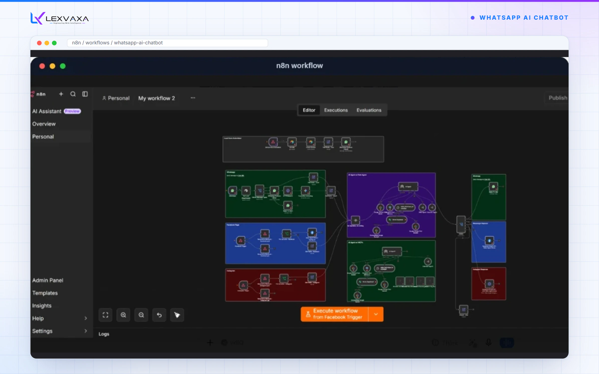

# WhatsApp AI Chatbot & Social Media Automation

**A modular AI chatbot in n8n that handles WhatsApp, Facebook and Instagram conversations with specialist agents and automated replies.**

       

## Overview

WhatsApp, Facebook and Instagram conversations were hard to manage in one maintainable workflow. Lexvaxa built an AI automation system in n8n with multi-channel message handling, specialist AI agents and sub-agents, MCP tool connections, webhooks and API integrations, and channel-specific routing with automated replies. Screens shown use sample data, so no client records are exposed.

## The challenge

Messages from three channels needed different handling, and one big workflow was becoming impossible to maintain.

## The solution

An n8n system with a routing layer, specialist agents and sub-agents per channel, MCP tools, webhooks and API integrations.

## Key features

- Multi-channel message handling
- Specialist AI agents and sub-agents
- MCP tool connections, webhooks and APIs
- Channel-specific routing
- Automated replies on WhatsApp, Facebook and Instagram

## Results

- A modular chatbot that can grow without rebuilding the whole workflow

## Tech stack

n8n · WhatsApp API · OpenAI · AI Agents · MCP · Webhooks · Meta APIs

## Privacy

Client names and records are confidential. Every screen in this repository uses sample data, and source code that belongs to the client is not published.

## Links

- Case study on Lexvaxa: https://lexvaxa.com/work/whatsapp-ai-chatbot
- Built by **Ch Muhammad Samiullah** ([GitHub](https://github.com/samiullah156-creator)) at [Lexvaxa](https://lexvaxa.com)
